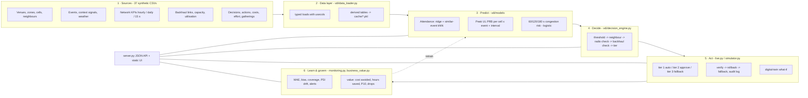

# Venue Demand Intelligence — Forecasting & Backhaul-aware Routing (PoC)

> **All data is synthetic.** Every venue, event, network KPI, cost and outcome in this repository
> comes from a synthetic dataset generated for this proof of concept. No real network or customer data is used.

An end-to-end, runnable proof of concept that **predicts uplink congestion at stadiums and events**, then
**recommends backhaul-aware traffic steering** with approval tiers, verification, rollback and fallback,
and **reports drift**. It ships with an executive-grade web UI (**two tabs**) served by a single
Python process.

* Backend: Python 3.10+ standard library + **pandas**, **numpy** and **python-dotenv** (no sklearn, no web framework).
* Models: implemented in numpy — ridge regression, similar-event kNN, residual-quantile prediction
  intervals, logistic regression (Adam gradient descent), isotonic response curves, PSI drift.
* Frontend: plain HTML/CSS/vanilla JS with a self-written SVG chart library. **No CDN, works offline.**

---

## Manager handoff

| Item | What this demo provides |
| --- | --- |
| Business question | Where might event-driven uplink congestion occur, and which simulated remedies are eligible? |
| Walkthrough | Forecast & recommendations, then Live operations; see the [executive guide](docs/EXECUTIVE-DASHBOARD-GUIDE.md). |
| Included | Source code, offline frontend, approved synthetic CSVs, pretrained models, and automated tests. |
| Required | Python 3.10+, an initial dependency installation, and approximately 396 MB of bundled CSVs. |
| Not included | Real network access, production authentication, actual traffic changes, or a hosted dashboard. |

Anyone with access to this GitHub repository can clone it or use **Code > Download
ZIP**, extract it, and follow the quick start below. The GitHub link shares the
code, not a running website. No API key is required for the executive demo.

## Executive workflow

The current interface has only **Forecast & recommendations** and **Live operations**.
The former eight-view assets and read-only APIs remain for compatibility, but are
not loaded or exposed as navigation in the executive interface.

* **Forecast & recommendations:** event selection, turnout range, modeled latency
  and packet loss, and ranked issue/evidence/remedy cards for radio headroom,
  backhaul capacity and TDD uplink slot readiness. This page is advisory:
  no preparation approval, no action execution, and no gate on page 2.
* **Live operations:** populated recorded synthetic telemetry streams by default
  at 15x demo speed (one 15-second sample per wall-clock second). Pause, select
  a cell, advance the replay or start a new run. All times refer to the recorded
  event, not today's network.
* **30-minute outlook:** separately trained ridge load and logistic congestion-bin
  models at 5, 10, 15, 20, 25 and 30 minutes. Earliest 19 events train, next 6 calibrate residual ranges,
  final 8 evaluate. Targets require exact time alignment and never cross events.
  At 15/20 minutes, held-out MAE is **3.87 / 4.19 PRB points**, compared with
  **6.33 / 7.23** for holding the current value; interval coverage is **91.1 / 91.0%**.
  Model evidence is available in a dialog. These are synthetic-data results.
  At 30 minutes, MAE is **4.64 PRB points** versus **8.66** for holding current
  load; band coverage is **90.9%**. The 25-30-minute congestion-bin model has
  AUC **0.9755**, precision **0.784**, recall **0.713**, Brier **0.0305**.
  These are not independently evaluated hardware/interference or SLA forecasts.
* **Rule-based operations:** persistent radio pressure (three samples >=70%
  with P10 <3 Mbps) triggers approved-playbook lookup. >=85% radio pressure or
  inter-site moves require engineer approval. Sustained site >85% / aggregation
  >90% breaches escalate because no alternate transport route is configured.
* Eligible remedies require **post-move** target radio utilization <=85%,
  safe transport and safe modeled service quality. Rank by approval tier,
  remaining headroom and coverage overlap. Bounded steering and an aligned
  uplink-heavy TDD profile are simulated playbooks. TDD changes always require
  engineer approval, neighbor alignment and protected downlink capacity.
  Tier 1 no longer requires a preparation approval.
* Both cells are reserved for a 10-minute cooldown. Validation after 120 replay
  seconds projects the move on the recorded no-action loads. Failures are marked
  rolled back and require escalation; automatic retries are blocked. Observed
  curves are never rewritten to imply a real recovery.
  Human rejections/escalations also hold that cell for the remainder of the run;
  start a new demo run to reset the hold.
* Populated **synthetic RTT and packet-loss scenarios** are written to
  `36_service_quality_15s_current_event.csv`. They combine original synthetic
  file-25 transport latency/loss with an illustrative radio-queue response,
  explicit TDD imbalance and RF impairment cases. They are not real measurements.
  Service rules use three samples above 50 ms RTT or 1% loss; these are demo
  budgets, not universal SLAs. Missing/invalid samples block automatic remedies.
  Version 2 also populates synthetic PUSCH SINR, BLER, HARQ, interference,
  handover, availability/alarms, compute, aggregate UL rate and lognormal P05 data.
* Live approvals, run cursors, decisions and validation outcomes persist
  atomically in `audit/operations.json`. Reload resumes the browser session;
  rewinding requires a new run. A forward jump evaluates issues at its destination,
  not every skipped sample. Validation still uses its exact scheduled timestamp.

The executive interface makes **no automatic Claude calls**. Numeric models and
operational policy are local. Existing optional Claude endpoints remain available,
but AI is not needed to run either tab. No real network control is connected.

Live approvals are reflected in queue transitions, replay-time validation progress
and source/receiver highlights. The review count excludes simulations already validating or verified.
Projected relief is labeled separately and never changes recorded observations.
Live state sync runs every four seconds while playback is paused.

Live alerts open a non-modal investigation panel that keeps streaming. It shows
rule evidence, ranked remedies and current policy authority; approval/escalation
buttons change with the latest rank. One alert per cell/run is updated in place.
Engineer approval requires the snapshot's `review_token`, so an outdated sample,
changed remedy or changed service evidence cannot be silently approved. Other action
requests remain subject to the existing server-side safety and cooldown checks.

Live operations now uses one combined observed/forecast radio graph, with RTT/loss
in the headline cards. Investigations show short issue names, multiple suspected
causes, ranked remedy alternatives, exact simulated parameter changes and effects.
A persisted case ledger filters Agent resolved / Engineer approved / Escalated
and replay-time windows. Validation checks every subsequent 15-second sample up
to +120s, rolling back early if any radio/transport/service gate fails. Legacy
action history is preserved without inventing unavailable detail.

The document-aligned UI separates demand/resources, radio quality/interference,
neighbors/mobility, and transport/availability/compute. Poor radio quality is not
treated as capacity alone. Comparable synthetic outcomes ground ranking, with
incomplete vendor/software/profile context disclosed. A visible assurance layer
shows approved scope, expiry, checks, rollback and human override. Only temporary
steering is automatic; TDD remains engineer-reviewed simulation. Other catalogue
actions need supported resources/adapters. Intents are vendor-neutral, not raw CLI.
Forecast watches trigger read-only serving/neighbor RCA before deterioration;
they do not execute a remedy without current diagnostic and policy preconditions.

Page 1 adds a five-minute interpolated all-cell display, a cell forecast brief
with nominal traffic/user-throughput scenarios and peak-risk timing, and a compact
preparedness catalogue. Scenario outputs are not presented as evaluated model heads.

Engineer approval uses a paused two-step review: wait for in-flight telemetry,
fetch current evidence, inspect the exact parameters, then explicitly confirm.
The snapshot token is still checked by the server. Changing the option or replay
position invalidates the review instead of submitting a moving-target approval.

See [the two-tab guide](docs/EXECUTIVE-DASHBOARD-GUIDE.md) for a plain-English walkthrough.
See [service scenario provenance](data/SERVICE-QUALITY.md) for formulas and limitations.

## Quick start

### 1. Download and prepare

Clone this repository or download and extract its ZIP, then open a terminal in
the project folder. The synthetic CSVs are already in `data/` and the pretrained
models are in `artifacts/`; no separate data download is needed.

Create an isolated environment and install dependencies:

**Windows (PowerShell)**
```powershell
python -m venv .venv
.\.venv\Scripts\python.exe -m pip install -r requirements.txt
.\run.bat
```

**macOS / Linux**
```bash
python3 -m venv .venv
.venv/bin/python -m pip install -r requirements.txt
bash run.sh
```

An internet connection is needed for the initial dependency installation.
After that, the ordinary dashboard works offline. The launchers prefer the
local virtual environment and install dependencies only when imports fail.

To use an alternative synthetic data folder, set `VDI_DATA_DIR`
(see [data/README.md](data/README.md)):

```bash
# Mac / Linux
export VDI_DATA_DIR="/path/to/Verizon data"
# Windows (PowerShell)
$env:VDI_DATA_DIR = "C:\path\to\Verizon data"
# Windows (cmd)
set VDI_DATA_DIR=C:\path\to\Verizon data
```

### 2. Open the dashboard

Wait for server startup, then open **http://localhost:8050**. Start with
**Forecast & recommendations**, choose an event, and then visit **Live operations**
to replay the recorded synthetic event. Stop the server with **Ctrl+C**.
Approvals and replay cursors belong to your local copy, not the GitHub repository.

### Manual commands
Run these with the virtual environment activated (`.\.venv\Scripts\Activate.ps1`
on Windows or `source .venv/bin/activate` on macOS/Linux), or use its Python
executable explicitly as in the quick start.

```bash
python -m pip install -r requirements.txt   # pandas + numpy + python-dotenv
python -m vdi.pipeline train                # build cache/ + train all models -> artifacts/ + artifacts/metrics.json
python -m vdi.pipeline score                # score upcoming 30-day events + the live event -> artifacts/scores.json, live.json
python -m vdi.server                        # http://localhost:8050  (--port / --host or VDI_PORT / VDI_HOST)
python -m unittest discover -s tests -t . -v
python scripts/smoke_check.py               # hits every endpoint of a running server
```

The first start builds `cache/` from the CSVs (≈30–60 s, pickled for fast restarts). Pre-trained `artifacts/`
are included; if they are missing the server trains automatically (≈2 min) before it starts.

### Validation and troubleshooting

```bash
python -m unittest discover -s tests -t . -v
```

The suite includes a local HTTP server test covering both executive tabs and
API endpoints; it does not call a real AI provider. GitHub Actions runs the suite
on Ubuntu/Python 3.10 and Windows/Python 3.13 and requires bundled data/models so
missing files cannot silently skip integration tests.

* **Python not found / unsupported:** install Python 3.10+ and recreate `.venv`.
* **Missing CSVs:** extract the entire repository, not only its Python files.
  Check `VDI_DATA_DIR` if you previously set it to another location.
* **Port already in use:** run `run.bat --port 8051` or `bash run.sh --port 8051`
  and open the corresponding URL.
* **First start is slow:** cache building is expected; wait for the server to
  finish rather than launching a second copy.

### Sharing boundaries

Only synthetic demo data is intended for publication. `.gitignore` excludes
`.env` and other environment files (except the template), virtual environments,
runtime caches, audit state, Office files, PDFs, and loose draft documents.
Project guides and diagram images remain available. Never commit credentials or replace
the synthetic data with real customer/network records.

This is an unauthenticated local PoC, not a production-ready service. Keep the
default `127.0.0.1` binding; GitHub Pages cannot run its Python backend.
Public visibility permits downloading, but does not itself grant an open-source
license. Add an owner-approved license before representing it as open source.

---

## Architecture



More detail in [docs/ARCHITECTURE.md](docs/ARCHITECTURE.md).

### Repository layout
```
verizon-venue-intelligence/
├── README.md · requirements.txt · run.sh · run.bat · .gitignore
├── config/settings.json        paths, thresholds (85 % PRB / 3 Mbps P10 / 3×15 s), steering, port 8050
├── data/                      bundled synthetic CSVs, dictionary, provenance, and data guide
├── docs/ARCHITECTURE.md        module ↔ pipeline-stage map, model cards, API reference
├── vdi/
│   ├── config.py               settings + env overrides
│   ├── data_loader.py          typed CSV loads, derived tables, pickle cache
│   ├── features.py             causal features (never uses true_occupancy_sim_only)
│   ├── models/core.py          numpy ridge / logistic / AUC / isotonic / PSI
│   ├── models/attendance.py    ridge + similar-event kNN, residual-quantile band
│   ├── models/peak_uplink.py   per cell-event peak UL PRB, 90 % interval, hourly profile
│   ├── models/short_horizon.py 60/120/180 s congestion risk on 15 s telemetry
│   ├── similar_events.py       kNN similar past events (+ file 11 reference list)
│   ├── decision_engine.py      backhaul-aware decision with explainable trace + verify
│   ├── simulator.py            digital-twin what-if
│   ├── live.py                 live replay: model risk, alerts, decision timeline
│   ├── monitoring.py           MAE / bias / coverage / PSI / alerts
│   ├── business_value.py       cost avoided, hours saved, P10 uplift, drops, congestion
│   ├── pipeline.py             CLI: cache | train | score | all
│   ├── api.py                  payload builders (precomputed at startup)
│   └── server.py               ThreadingHTTPServer: /api/... + static UI
├── static/                     index.html, css/app.css, js/app.js, js/charts.js, js/views/*.js, assets/
├── tests/                      unittest: decision rules, simulator monotonicity, model sanity, API smoke
├── scripts/smoke_check.py      endpoint checker for a running server
└── artifacts/                  trained models (json/npz), metrics.json, scores.json, live.json
```

### Legacy views (retained assets, not current navigation)
1. **Executive overview** – 6 KPI tiles, uplink growth 2016–2026, app mix, 30-day venue risk board, 3 headlines.
2. **Event forecast** – upcoming events with attendance band and risk; cell × hour heatmap, similar past events, context signals.
3. **Live command center** – 15 s replay of `EVT-LIVE-20261028` (play/pause, 1×–60×, scrubber), per-cell gauges,
   60/180 s risk, forecast vs actual, alerts, recommended action with the backhaul-aware trace, Approve / Reject (audited),
   verify → rollback → fallback states. Deep link: `#/live/<seconds-from-kick-off>[/paused]`.
4. **Routing & backhaul** – decision funnel, blocked reasons, tiers, site vs aggregation utilisation, steering actions detail.
5. **What-if simulator** – attendance %, home/away, % traffic steered, temporary capacity → before/after.
6. **Unplanned gatherings** – counts by type, social vs network-only detection lead, 15 s replay.
7. **Model health** – MAPE / bias / coverage trend, PSI drift, alerts, versions, trained-model metrics.
8. **Data catalog** – all 37 files with grain/coverage/rows, searchable column dictionary.

Every number in the UI is computed from the CSVs / trained models via the API — nothing is hard-coded.

### Branding
The UI uses a Verizon-inspired palette (red `#EE0000`, black, white, greys) but **does not reproduce any Verizon logo
or trademark**. Replace `static/assets/logo-placeholder.svg` (≈132×32) with an approved brand asset.

### Configuration
`config/settings.json` holds paths, the placeholder congestion rule (UL PRB > 85 % and UL P10 < 3 Mbps for 3
consecutive 15 s intervals, from `21_thresholds_policy.csv`), the safety checks (neighbour radio headroom ≥ 15 %,
target site backhaul ≤ 85 % after the move, aggregation ≤ 90 %), steering parameters and the port.
Env overrides: `VDI_DATA_DIR`, `VDI_HOST`, `VDI_PORT`, `VDI_CACHE_DIR`, `VDI_ARTIFACTS_DIR`, `VDI_AUDIT_DIR`.

### Known limitations
* Synthetic data only; thresholds are placeholders that need Verizon approval.
* The live view is a replay of the recorded stream: "verify" applies the steering effect to the observed
  no-action loads (digital-twin style), it does not change the recorded data.
* Legacy approvals use `audit/approvals.jsonl`; executive operations use
  `audit/operations.json`. Both are local runtime state with no authentication.
* The simulator is a first-order twin (monotone response curves, proportional backhaul scaling).

### Legacy interactive views (not loaded by the executive shell)
* **Overview:** filter the venue risk board by venue/risk, sort it, and click event dots for forecasts.
  Portfolio KPI tiles, growth and headlines stay global.
* **What-if simulator:** use five presets or attendance/steering/capacity sliders; pin a result for a
  side-by-side comparison. Save up to eight named scenarios in this browser, then load, compare or delete
  them. Saved plans persist across reloads; they are not shared across browsers.
* **Synthetic streaming replay:** play/pause/scrub or jump to congestion and human-approval events.
  Compare the historical event forecast, cursor-bounded observations, matured 60-second predictions,
  and the next 60-second estimate. Error is observed minus predicted; MAE uses elapsed samples only,
  with a trailing five-minute adaptive MAE unavailable until a prediction matures.
  Per-cell routing shows no action, automatic eligibility, engineer approval or fallback/NOC escalation.
  The action comparison is a single hypothetical projection, not real execution or a combined routing plan.

## Optional Claude analyst

The retained legacy views include an on-demand Claude analyst for summaries, forecast explanations,
live decision explanations and scenario advice. Numeric predictions and radio/backhaul checks
remain local and unchanged. Claude cannot approve or execute actions.

The server automatically loads the workspace-root `.env` file using `python-dotenv`, included
in `requirements.txt`. Open `.env` and paste your key after `ANTHROPIC_API_KEY=`:

```dotenv
ANTHROPIC_API_KEY=your-key-here
ANTHROPIC_MODEL=
```

Leave the model blank to select it in the dashboard. If `.env` is absent, copy `.env.example`.
Run `.\run.bat` (Windows) or `./run.sh` (macOS/Linux), and restart after changing `.env`.
The file is excluded by `.gitignore`; never share it or put keys in JavaScript, screenshots or chat.
The loader uses the project root even when launched from another directory. Existing environment
variables take precedence, including empty ones, and `${...}` in values is treated literally.
Remove a previously set terminal variable if you want the file value to apply.

Alternatively, set `ANTHROPIC_API_KEY` in the server's environment. In Windows PowerShell, enter it
without displaying it or saving its value in command history:

```powershell
$secret = Read-Host "Anthropic API key" -AsSecureString
$env:ANTHROPIC_API_KEY = [System.Net.NetworkCredential]::new("", $secret).Password
.\run.bat
```

The Windows launcher prefers `.venv\Scripts\python.exe` when present. On macOS/Linux the launcher
prefers `.venv/bin/python` unless `PYTHON` is set. Otherwise the existing system-Python fallback applies.

In the dashboard click **Load available models**, select the exact model ID provided by Anthropic,
then click **Ask Claude**. No model is assumed from a marketing name such as "Opus 5".
Optionally set `ANTHROPIC_MODEL` to an exact model ID before starting the server.

Loading models contacts `https://api.anthropic.com/v1/models`; explanations contact `/v1/messages`.
Model loading and **Ask Claude** contact Anthropic. In the simulator, **Auto-analyze scenario changes**
is enabled by default as requested: once a model is selected, changed results trigger a billed request
after a two-second debounce, with at most one request in flight per panel. Uncheck it to use manual
questions only. Provider errors pause automatic analysis until re-enabled. Startup, navigation and
replay ticks do not generate explanations. Asking about a replay pauses playback to keep context stable.
Explanations send a bounded server-built selection of synthetic dashboard facts and your question;
they do not send CSV files, source code, API keys in prompts, or approval-log comments/usernames.
Forecast explanations use the selected event; simulator advice uses the last rendered scenario;
live explanations use the current replay position and visible decision, not future verification results.
Other views use aggregate summaries (model health includes the latest 12 weekly history points).
Follow-up questions include a bounded recent conversation held in memory. Changing the selected
scenario/event/filter/cursor clears old advice; navigation or **Clear conversation** also discards it.
Do not enter confidential information. API usage can incur Anthropic charges.

AI endpoints are restricted to the local machine and same-origin browser requests. Keep this
unauthenticated PoC bound to `127.0.0.1`; add authentication, quotas and organizational data-handling
approval before any shared/production deployment. Provider errors are shown explicitly; there is
no fabricated fallback answer. Without a key, the ordinary dashboard remains fully usable.

Routes: `GET /api/ai/status`, `POST /api/ai/models`, `POST /api/ai/explain`.
The explain body is `{view, model, question, selection, history?}`; selection is resolved against server
data, not accepted as arbitrary facts. Successful answers include `text`, `model`,
`advisory_only`, `truncated` and provider token `usage`.
