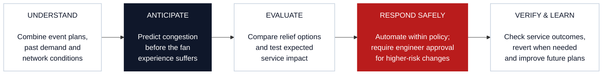

# Intelligent venue networks

## Anticipate demand. Protect fan experience. Use capacity wisely.

Executive summary of the [proposed network automation workflow](NETWORK-AUTOMATION-FLOW.md).

### Intended business value

- **Protect experience:** fewer congestion-related service problems.
- **Optimize investment:** use existing capacity before adding more.
- **Scale operations:** focus engineers on exceptions and higher-risk decisions.

### Governance throughout

Capacity safety checks | Human oversight | Audit trail | Revert and escalation

**Status:** proposed target-state workflow. The current proof-of-concept uses
synthetic data and simulated actions; it does not control a real network.
Business outcomes are objectives, not verified production results.
