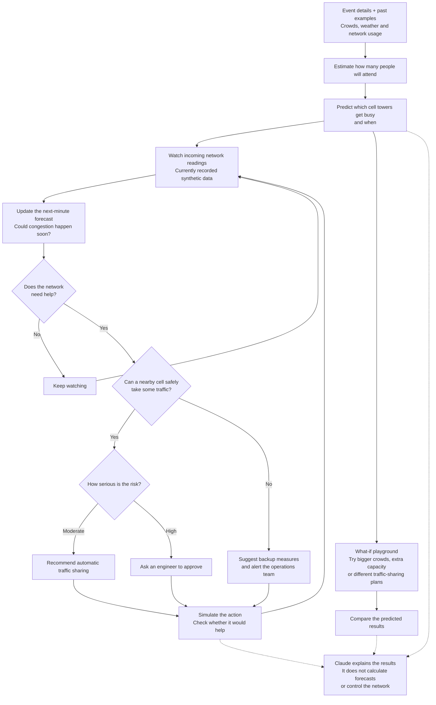

# How the dashboard works

Think of it as a traffic planner for a stadium's mobile network: it predicts
where the network may get crowded and suggests ways to ease the pressure.

Example: "A big crowd is expected. This cell may become overloaded. A nearby
cell has spare room - sharing some traffic could help."

Today, it is a simulation: it does not read a real Verizon live feed or change
actual network settings.
