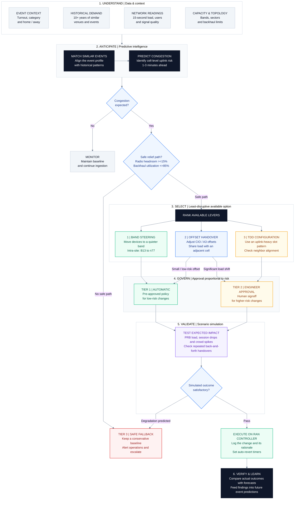

# Proposed network automation workflow

Based on [new.md](new.md).

This diagram describes a proposed design, not the current dashboard's implemented
capabilities. Real telemetry intake, ranked band/handover/TDD control, ping-pong
evaluation, and RAN-controller execution are proposed integrations. The current
dashboard uses synthetic data and simulated actions.

